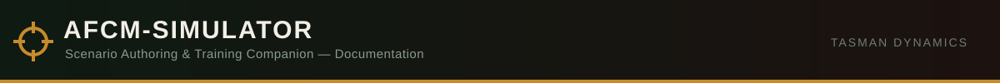

<div align="center">



[README](../../README.md) · [Design](../DESIGN.md) · [References](../REFERENCES.md) · [Addons](../addons/README.md) · [Injury Codes](../INJURY_CODES.md) · [Field Manual](../FIELD_MANUAL.md) · [Steam Description](../STEAM_DESCRIPTION.md) · [Changelog](../changelogs/README.md) · **Steam Changelog**

</div>

# Steam Workshop Change Note (2026-11-03)

**Note on format**: same convention as `docs/STEAM_DESCRIPTION.md` — Steam's own BBCode tags, not
Markdown. Copy everything inside the fence below and paste it directly into the Workshop item's
**Change Note** field when publishing this update.

---

```text
[b]Added[/b]
[list]
[*] Zeus Spawn Patient module now has a real Unit Type dropdown - pick a faction, then pick a specific role (Rifleman, Medic, Officer, Engineer, Pilot, etc.) from that faction, just like the vanilla Reinforcements module
[/list]

[b]Changed/Fixed[/b]
[list]
[*] Addon Options still weren't showing up in the Eden Editor - found and fixed the real cause (a missing CBA dependency)
[*] AFCM Patient Module's Casualty Type/Training Preset dropdowns could silently store "true" instead of your actual selection - fixed
[*] Edit Injuries window: Unconscious checkbox moved to the right of its label, label now matches the Blood/SpO2 text styling
[*] Medical Terminal module: success/failure messages are now a quick hint instead of a big popup, and the module disappears instantly when placed somewhere with nothing to attach to
[*] Zeus Spawn Patient: fixed a bug where it wasn't opening the Edit Injuries window after spawning a patient like it was supposed to
[/list]
```
